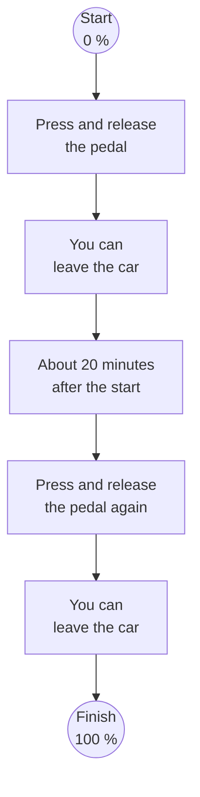

# Update to 74.00.324A

The Revised Store and its apps are built for Mazda Connect (CMU150) firmware **74.00.324A**, European version. This guide takes the unit there with Mazda's own update procedure.

::: danger Do not let the power drop
The update rewrites the unit's whole system. If the ignition turns off or the battery sags in the middle of it, the unit can stop working and need replacing. Read the [power](#keep-the-power-on) part before you start.
:::

## Check your version first

On the car's screen: **Settings → System → About → Version Info**. The window shows three lines. Two of them matter:

- **OS Version is …**: the main system.
- **Fail Safe Version is …**: the backup system the unit starts when the main one is broken. The Store's last-resort recovery relies on it.

Both must show **74.00.324A**.

| OS Version | Fail Safe Version | What to do |
|---|---|---|
| 74.00.324A | 74.00.324A | You are done. Go to [[install-store|Install the Store]]. |
| 74.00.324A | older, or "Not Available" | Follow this guide anyway. The update writes the fail-safe system too. |
| 70.00.335 or later | anything | Follow this guide. |
| older than 70.00.335 | anything | These units first need a separate Fail-safe package. This guide does not cover that case. |

Check both lines again after the update.

## Get the update file

The firmware is Mazda's intellectual property, so we cannot publish it here. A Mazda dealer can install 74.00.324A for you.

Owners share the file freely. Search for its name, `cmu150_EU_74.00.324A_update.up`, with a search engine, on Reddit or on Mazda owners' forums.

::: danger Never pay for the firmware
Sites that sell it are after your money. The file is shared for free.
:::

## Check the MD5 before you install

A damaged or altered file can break the unit. Before you install, check that your copy is exactly this one:

| | |
|---|---|
| File name | `cmu150_EU_74.00.324A_update.up` |
| Size | 2 432 208 800 bytes |
| MD5 | `9b841bc807a5010a8652bb3b9e894f91` |

Open a terminal in the folder with the file and run the command for your system.

Each command compares the MD5 for you. It takes a minute on a 2.4 GB file.

**Windows** (PowerShell: right-click the Start button → Terminal):

```powershell
if ((Get-FileHash cmu150_EU_74.00.324A_update.up -Algorithm MD5).Hash -eq '9b841bc807a5010a8652bb3b9e894f91') { 'OK' } else { 'WRONG FILE' }
```

**macOS** (Terminal):

```sh
[ "$(md5 -q cmu150_EU_74.00.324A_update.up)" = 9b841bc807a5010a8652bb3b9e894f91 ] && echo OK || echo "WRONG FILE"
```

**Linux**:

```sh
echo "9b841bc807a5010a8652bb3b9e894f91  cmu150_EU_74.00.324A_update.up" | md5sum -c
```

You must see **OK**. Anything else (`WRONG FILE`, `FAILED`, or an error that the file is not found) means: stop.

If the MD5 or the size differ, **do not install the file**. Get another copy and check it again.

The file must end in **`.up`**. If you got a `.zip`:

- **The zip contains `cmu150_EU_74.00.324A_update.up`** (often with instructions next to it): unzip it and use only the `.up` file.
- **The zip contains no `.up` file, and the zip itself is 2 432 208 800 bytes:** it is the update itself under the wrong name. Do not unzip it, rename it to `cmu150_EU_74.00.324A_update.up`.

Either way, check the MD5 of the final `.up` file.

## Put it on a stick

[[usb-stick|Prepare a USB stick]] of 8 GB or more, formatted FAT32. Then copy the `.up` file to the top level of the stick. Put nothing else on it: with one file there, the car cannot pick the wrong one.

## What the update resets

- All settings go back to factory: sound, display, radio favourites, navigation favourites.
- Paired phones are forgotten. Before you pair a phone again, remove **Mazda** from the phone's Bluetooth list, or it will not pair.
- Everything installed from the Revised Store is removed. Install the Store again afterwards.

Write down your radio favourites now if you want them back.

## Manual or automatic: which pedal

The steps below use two pedal actions. Which pedal depends on your gearbox:

| Your car | Pedal |
|---|---|
| **Automatic** (AT) | **brake** pedal |
| **Manual** (MT) | **clutch** pedal |

- **ACC without the engine**: press the START/STOP button once **without** touching the pedal. The START button light turns amber and the instrument cluster stays dark. If you press the pedal while pushing START, the engine starts: do not.
- **Keep ACC alive**: press the pedal and let it go, **without** touching START. The engine does not start. This only resets the car's 25-minute timer.

## Keep the power on

The update itself takes about 40 minutes, the whole procedure about an hour.

- Keep the ignition in **ACC** all the time. Not ON, and never start the engine.
- The car turns ACC off by itself after **25 minutes**. Press and release the pedal (see above) before that happens. Set a timer on your phone for 20 minutes.
- Connect a battery charger in power-supply mode if you have one. A weak battery is the most common way to ruin an update.
- Switch off what draws current: air conditioning fan, rear window heater, interior lights.

When to press the pedal during the update:



If the update runs past 40 minutes, press the pedal once more 20 minutes after the last time.

## Run the update

The steps follow Mazda's service bulletin and keep its numbering, so you can compare them side by side.

### Prepare the unit (steps 1–8)

1. With the ignition **off**: take out the navigation SD card. Unplug everything from the USB and AUX ports. Disconnect phones.
2. Switch to **ACC** (START once, no pedal). Wait until the system has started.
3. Turn on the radio: **AM, FM or DAB**.
4. Press and hold **Music + Favourites + Mute** on the commander together for 2–5 seconds. The **Diagnostic Test** screen opens.
5. Enter **3** with the touchscreen or the commander knob, choose **ENTER**, then **CLEAR**.
6. Enter **2**, choose **ENTER**. This clears the unit's stored fault codes. Choose **CLEAR**, then **EXIT**.
7. Switch the ignition **off**. Close all doors, lock the car with the remote, take **all** keys at least **5 metres** away from the car, and wait **3 minutes**. The unit goes fully to sleep.
8. Unlock the car with the remote and switch to **ACC** (START once, no pedal).

### Start the update (steps 9–13)

9. Plug the stick into **one** USB port. Leave the other USB port and the SD slot empty.
10. A message shows briefly that the stick was found. No message: unplug the stick and go back to step 9.
11. Press and hold **Music + Favourites + Mute** for 2–5 seconds again.
12. Enter **99** and choose **ENTER**.
13. Choose **Search**.

Steps 14–21 of the bulletin install a separate Fail Safe Package. Mazda dropped it from 70.00.335 on, so 74.00.324A skips them.

### Install (steps 22–24)

22. Choose **Update Package**.
    (A unit on 70.00.110 or older shows **Reinstallation Package** instead.)
23. Choose **Update** (or **Install** on older units).
24. The screen shows "Preparing to update", goes black, then white, then a progress bar runs from 0 to 100 %. About **40 minutes**.
    - **Press and release the pedal now**, at the start, and again after about 20 minutes (see the chart above).
    - The bar stops for several minutes around 12 % and 91 %, and again between 98 % and 100 %. That is normal. Wait.
    - The screen can get dark. Never switch the ignition off and never start the engine.

### Finish (steps 25–30) {#finish}

25. At 100 % the screen asks to restart. **Do not start the engine.** Switch the ignition **off** without pressing any pedal.
26. Take out the stick. Close all doors, lock the car with the remote, take all keys 5 metres away, and wait **3 minutes**.
27. Unlock with the remote and switch to **ACC** (START once, no pedal). Touch nothing for **one minute** while the unit sets itself up.
28. Check **Settings → System → About → Version Info**: both **OS Version** and **Fail Safe Version** show **74.00.324A**.
29. Switch the ignition **off**.
30. Put the navigation SD card back. Open the map: if the position is wrong, drive about 50 metres at 15 km/h or more until it corrects itself.

Then [[install-store|Install the Store]].

## If something goes wrong

**The car switched off during the update.** Switch back to ACC. The update continues on its own. If nothing moves after 1–2 minutes and the stick has a light that is not blinking, take the stick out and plug it in again.

**The update does not finish: the screen stays white or freezes.**

1. Switch the ignition **off**. Do not start the engine.
2. Wait until the screen is black.
3. Take out the stick.
4. Remove the **ROOM** fuse in the engine-bay fuse box and wait one minute.
5. Put the ROOM fuse back.
6. Switch to **ACC**. Not ON, do not start the engine.
7. Wait for the unit's update screen.
8. Plug the stick in again.
9. Check that the update starts again.
10. When it reaches 100 %, go on from [step 25](#finish).

::: tip Source
These steps follow Mazda's service bulletin "MZD Connect CMU software update procedure" (worldwide version), in our own words and with the same step numbers. The bulletin is the reference.
:::
